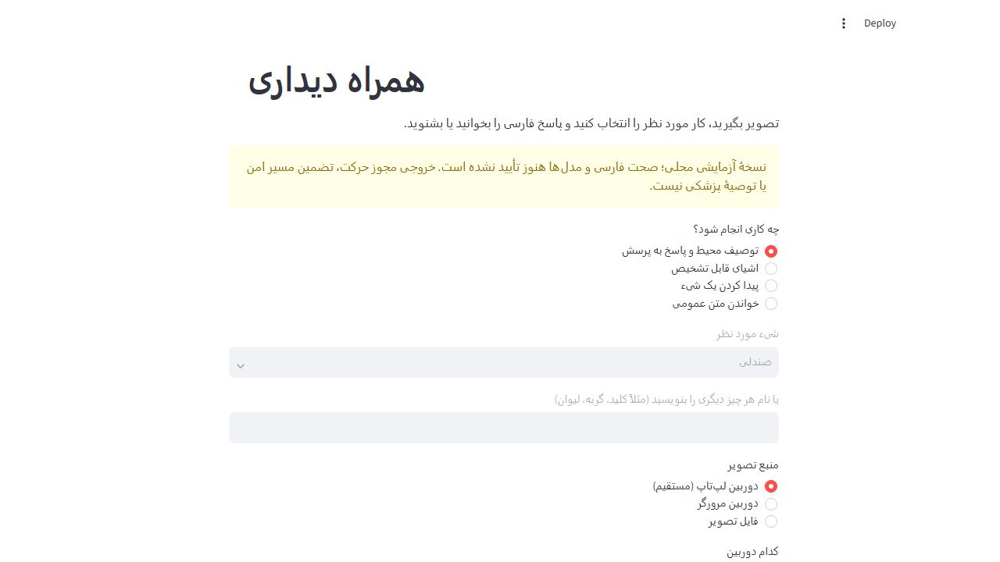
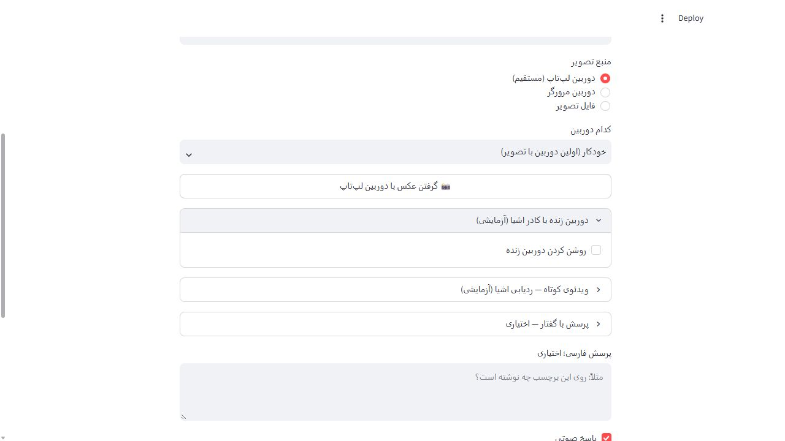
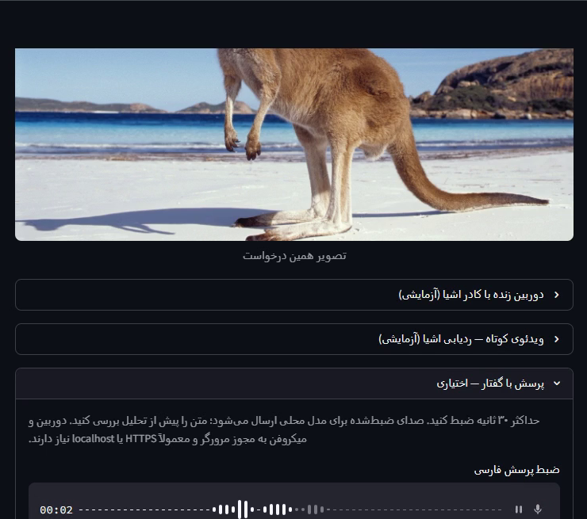
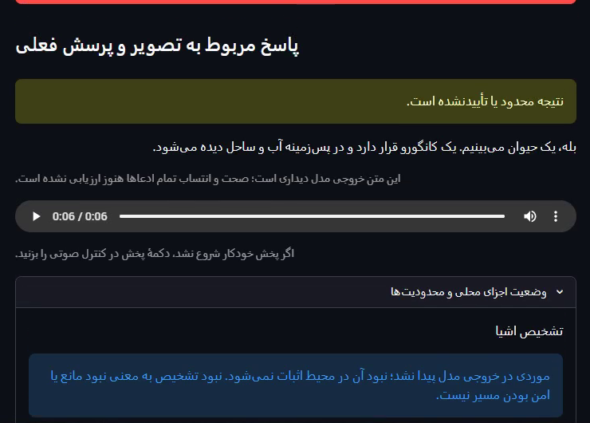
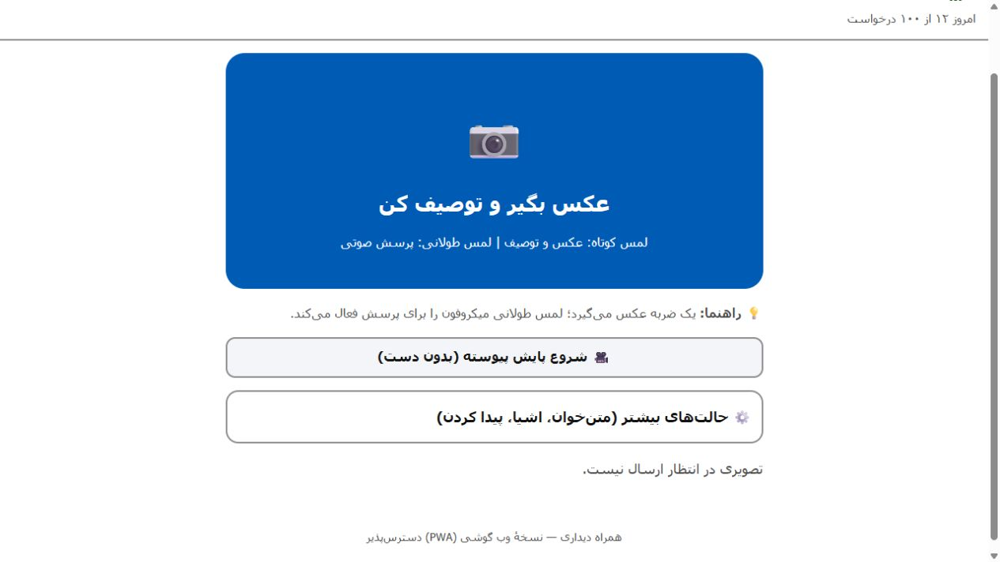
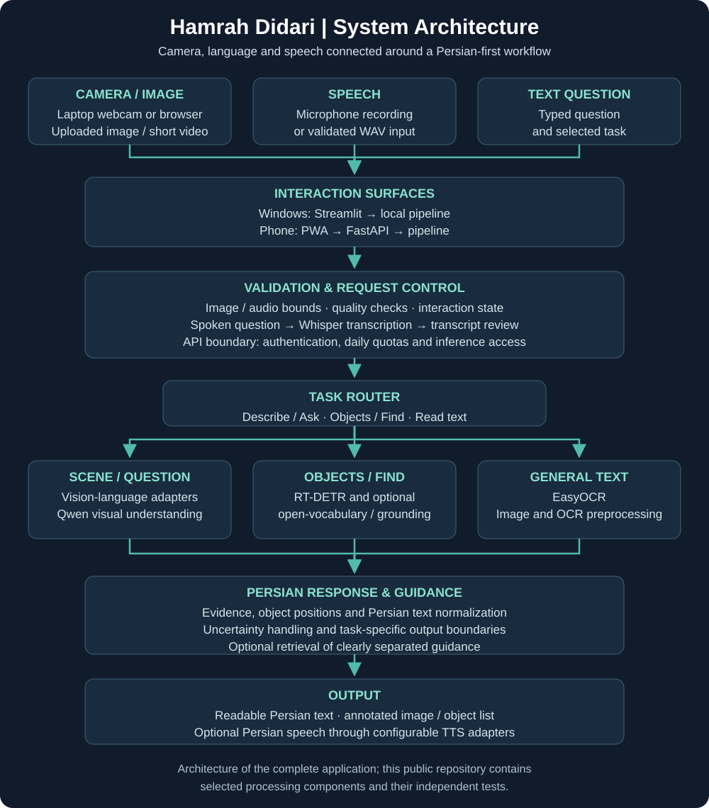

# همراه دیداری فارسی

**دستیار دیداری فارسی برای نابینایان و کم‌بینایان — پروژهٔ فاینال دوره جامع هوش مصنوعی سماتک**

توسعه‌دهنده: **محمدمیلاد حداد** · استاد دوره: **وحید قربانی**

[English](README.md) · [معماری](docs/ARCHITECTURE.md) · [قابلیت‌ها](docs/CAPABILITIES.md) · [دامنهٔ بررسی‌ها](docs/VALIDATION.md)

هدف پروژه، پاسخ به نیازهای روزمره مانند توصیف محیط، خواندن متن عمومی فارسی و انگلیسی، فهرست‌کردن اشیا، یافتن شیء پشتیبانی‌شده و پرسش‌وپاسخ صوتی در یک رابط فارسی است.

## نسخهٔ ویندوز و دوربین لپ‌تاپ

نسخهٔ اصلی Streamlit روی ویندوز، گرفتن مستقیم عکس با دوربین لپ‌تاپ، ورودی دوربین مرورگر و فایل تصویر را در اختیار کاربر می‌گذارد. پنل دوربین زنده با کادر اشیا و ردیابی ویدیویی نیز به‌صورت آزمایشی وجود دارند.

این تصاویر از خود برنامهٔ محلی ویندوز ثبت شده‌اند؛ محیط و کنترل‌ها را نشان می‌دهند. هنگام تهیهٔ آن‌ها عکس دوربین گرفته نشده و استنتاج مدل اجرا نشده است؛ بنابراین تصویر نتیجهٔ تشخیص نیستند.

گردش کار بخش دوربین: **گرفتن تصویر ← انتخاب نوع تحلیل ← دریافت پاسخ فارسی به‌صورت متن یا گفتار**.

### نمونهٔ ضبط‌شده از اجرای ویندوز

دو فریم زیر از ویدیوی ارسالی مالک استخراج شده‌اند: تصویر ورودی کانگورو و پاسخ فارسی بعدی همراه با پخش صوتی.

منبع: حدود ۰۰:۵۶ و ۰۲:۲۷ از ضبط ارسالی. کادرها به محدودهٔ برنامه محدود شده‌اند و فایل اصلی تغییر نکرده است. این نمونه از فایل تصویر استفاده می‌کند، نه گرفتن عکس با وب‌کم؛ نمایش آن ارزیابی مستقل دقت یا معیار زمان پاسخ نیست.

## نسخهٔ وب مناسب گوشی

این تصویر از رابط واقعی وب با سرور پیش‌نمایش توسعه ثبت شده است. وضعیت اتصال و سهمیهٔ نمایش‌داده‌شده شبیه‌سازی است؛ تصویر، شاهد دقت مدل یا استقرار زنده نیست.

## نمونه‌کدهای قابل اجرا

۱۰ ماژول پردازشی انتخاب شده‌اند: قرارداد خروجی، آماده‌سازی تصویر و صوت، اعتبارسنجی کادر مدل، پردازش فارسی، قطعه‌بندی، ترسیم کادرها، جمله‌سازی فارسی، ردیابی و مدل توالی اختیاری.

[راهنمای کد](docs/CODE_MAP.md) · [تست‌ها](tests) · [مثال اجرایی](examples/quick_demo.py)

~~~sh
python -m pip install -r requirements-dev.txt
python -m pytest -q tests
python -m examples.quick_demo
~~~

نسخهٔ گلچین با **۲۱ تست و ۶ زیرآزمون** مستقل بررسی شده است؛ این عدد با ۲۶۶ تست نسخهٔ کامل یکی نیست. مثال از تصویر و صدای مصنوعی استفاده می‌کند و به دوربین، شبکه یا مدل سنگین نیاز ندارد.

## شماتیک کامل

## چرا این پروژه بیش از یک اتصال ساده به مدل است؟

- هماهنگ‌کردن ورودی تصویر و صدا، وضعیت درخواست و خروجی متن و گفتار در یک خط لوله.
- تفکیک اجزای بینایی، تشخیص، OCR، گفتار ورودی و صدای خروجی پشت قراردادهای مشخص.
- پردازش فارسی، اعلام عدم قطعیت و جلوگیری از خواندن خودکار اعداد تأییدنشدهٔ OCR.
- رابط Streamlit و رابط وب مناسب گوشی، همراه با API، کنترل ورودی، سهمیه و مدیریت درخواست.
- آزمون رفتار نرم‌افزار بدون نیاز به اجرای مدل‌های سنگین در هر آزمون.

در اجرای ۲ نوامبر ۲۰۲۶، **۲۶۶ تست و ۲۹ زیرآزمون موفق** بودند. این عدد به آزمون نرم‌افزار مربوط است؛ دقت میدانی، کیفیت گفتار و پذیرش دسترس‌پذیری را ثابت نمی‌کند.

این مخزن معرفی فنی پروژه و یک مجموعهٔ گلچین از کدهای واقعی آن است؛ کد کامل برنامه، وزن مدل‌ها و تنظیمات خصوصی در این نسخه منتشر نشده‌اند. آزمون با کاربران نابینا و کم‌بینا و بررسی واقعی صفحه‌خوان روی گوشی هنوز باز است. پروژه ابزار ایمنی حرکت نیست و خواندن برچسب دارو خارج از دامنهٔ آن است.

این کار به‌عنوان فاینال **دوره جامع هوش مصنوعی سماتک** ارائه می‌شود. از استاد **وحید قربانی** و مجموعهٔ **سماتک** بابت آموزش‌های دوره سپاسگزارم.

[ارتباط در لینکدین](https://www.linkedin.com/in/mohamadmilad-hadad-1026761ba/)
