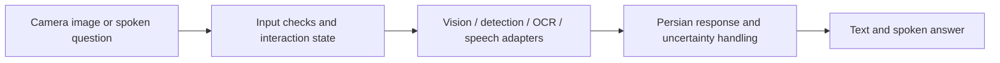

# Hamrah Didari · همراه دیداری

**A Persian-first visual assistant for blind and low-vision users.**

An everyday question — *What is in front of me? Where is the object? What does this text say?* — should be answerable in the user's own language. Hamrah Didari brings visual understanding, text reading and voice interaction into one Persian interface.

**Final capstone project · Sematec Comprehensive Artificial Intelligence Course**  
Developed by **Mohamadmilad Hadad** · Course instructor: **Vahid Ghorbani (وحید قربانی)**

[فارسی](README.fa.md) · [Architecture](docs/ARCHITECTURE.md) · [Capabilities](docs/CAPABILITIES.md) · [Verification](docs/VALIDATION.md) · [Connect on LinkedIn](https://www.linkedin.com/in/mohamadmilad-hadad-1026761ba/)

> This repository is the project's public technical showcase. It contains the case study, interface screenshots and architecture; the application implementation and model files are not distributed here.

## From a picture to a useful Persian response

| User task | Project capability |
| --- | --- |
| Understand a scene | Produce a concise description and acknowledge uncertainty. |
| Read everyday text | Process general Persian and English text with OCR. |
| Find an object | Return supported detections and positions relative to the camera frame. |
| Ask a spoken question | Transcribe the question, allow review, and produce a response. |
| Hear the answer | Present Persian text and speech through configurable adapters. |

## Interface

*Screenshots show the actual web interface connected to its development preview server. Readiness and quota indicators are simulated; these images are UI previews, not evidence of model accuracy or a live deployment. No participant photographs or recordings are included.*

## The engineering behind the interface

- **A shared multimodal pipeline:** Streamlit and a phone-oriented web interface connect to the same analysis concepts.
- **Replaceable components:** vision-language, detection, OCR, speech recognition and speech synthesis sit behind explicit result contracts.
- **Persian handling:** text normalization and speech preparation are part of the response path.
- **Bounded processing:** validated image/audio inputs, request state and cancellation handling, controlled inference access and daily usage quotas.
- **Careful output:** relative directions stay tied to the camera frame; uncertain OCR numbers are not automatically spoken as confirmed facts.
- **Testable boundaries:** model substitutes let interface, API, state and validation behavior be tested without running GPU inference.

Implemented components include Python, Streamlit, FastAPI, a PWA frontend, Qwen vision-language adapters, RT-DETR detection, EasyOCR, Whisper and configurable Persian speech backends. The work integrates existing model families; it does not claim to have trained a foundation model from scratch.

## Verification snapshot

**266 software tests + 29 subtests passed on 2 November 2026.** These exercise application behavior and controlled backend contracts. They do not establish real-world model accuracy, accessibility acceptance or production readiness. See the [verification notes](docs/VALIDATION.md) for scope.

This is a course capstone and an evolving assistive-technology prototype. It is not a navigation safety system; medicine-label reading is outside its scope. Field testing with blind and low-vision users and physical-device screen-reader checks remain open.

## Course and project context

The capstone connects computer vision, OCR, language processing, speech interfaces and application engineering in a single use case. Thank you to **Sematec** and **Vahid Ghorbani** for the course instruction.

For technical discussion, evaluation opportunities or collaboration, [contact Mohamadmilad Hadad on LinkedIn](https://www.linkedin.com/in/mohamadmilad-hadad-1026761ba/).
