
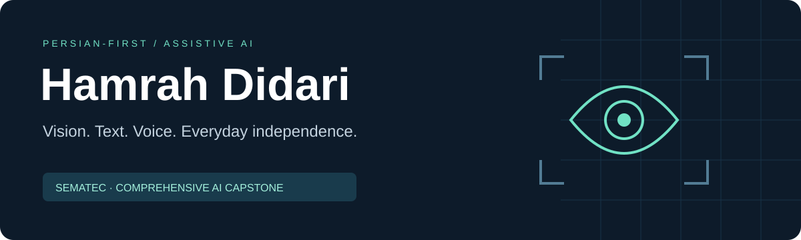

# Hamrah Didari · همراه دیداری

**A Persian-first visual assistant for blind and low-vision users.**

An everyday question — *What is in front of me? Where is the object? What does this text say?* — should be answerable in the user's own language. Hamrah Didari brings visual understanding, text reading and voice interaction into one Persian interface.

**Final capstone project · Sematec Comprehensive Artificial Intelligence Course**  
Developed by **Mohamadmilad Hadad** · Course instructor: **Vahid Ghorbani (وحید قربانی)**

[فارسی](README.fa.md) · [Architecture](docs/ARCHITECTURE.md) · [Capabilities](docs/CAPABILITIES.md) · [Verification](docs/VALIDATION.md) · [Connect on LinkedIn](https://www.linkedin.com/in/mohamadmilad-hadad-1026761ba/)

> This repository presents the project and publishes a curated, runnable selection of its processing code: image/audio preprocessing, grounding, segmentation, tracking and Persian text handling, with focused tests. The complete application, operational configuration, source recordings, datasets and model weights remain outside this release.

## Explore the selected code

| Component | Engineering focus |
| --- | --- |
| [Image preparation](accessible_assistant/vision_preprocess.py) | Blur, brightness, contrast, enhancement and OCR regions. |
| [Grounding parser](accessible_assistant/grounding.py) | Validate model-produced boxes and reject malformed geometry. |
| [Audio preparation](accessible_assistant/audio_preprocess.py) | Voice activity, denoising and MFCC features. |
| [Segmentation](accessible_assistant/segmentation.py) | GrabCut masks and text-component splitting. |
| [Tracking](accessible_assistant/tracking.py) | IoU association and frame-relative motion trends. |
| [Sequence model](accessible_assistant/sequence_model.py) | Optional compact GRU, with a fallback when weights are absent. |
| [Persian descriptions](accessible_assistant/scene_text.py) | Traceable Persian sentences and compact detection evidence. |
| [Overlay rendering](accessible_assistant/annotate.py) | Boxes, OCR polygons and masks on a copy of the image. |
| [Text normalization](accessible_assistant/persian_text.py) | Persian letters, digits and whitespace normalization. |
| [Result contracts](accessible_assistant/contracts.py) | Explicit status, timing, data and bounded metadata. |

[Code guide and release scope](docs/CODE_MAP.md) · [Tests](tests) · [Runnable example](examples/quick_demo.py)

### Run the published selection

~~~sh
python -m venv .venv
# Windows: .venv\Scripts\activate
# Linux/macOS: source .venv/bin/activate
python -m pip install -r requirements-dev.txt
python -m pytest -q tests
python -m examples.quick_demo
~~~

The example saves a synthetic annotated image and a JSON report in output/demo. It opens no camera, downloads no model and sends no network requests. The core selection runs on CPU; optional GRU training needs PyTorch and uses synthetic trajectories.

## From a picture to a useful Persian response

| User task | Project capability |
| --- | --- |
| Understand a scene | Produce a concise description and acknowledge uncertainty. |
| Read everyday text | Process general Persian and English text with OCR. |
| Find an object | Return supported detections and positions relative to the camera frame. |
| Ask a spoken question | Transcribe the question, allow review, and produce a response. |
| Hear the answer | Present Persian text and speech through configurable adapters. |

## Windows desktop and laptop camera

The local **Streamlit application on Windows** provides direct laptop-camera capture alongside browser-camera and file input. Its experimental live-camera panel exposes object-box detection controls.

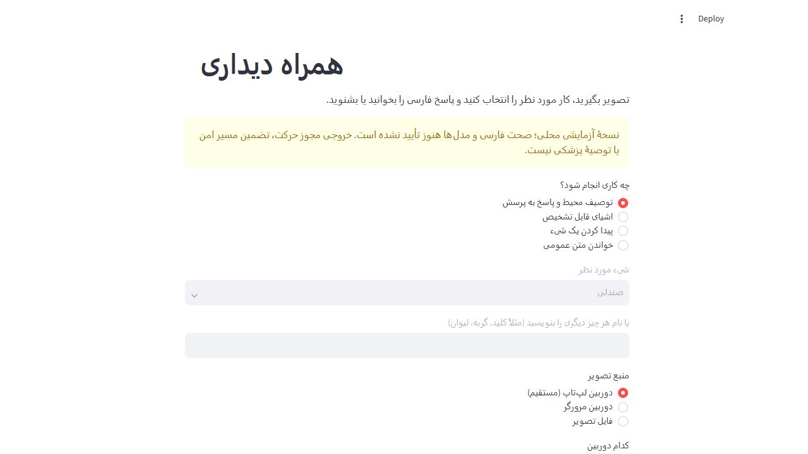

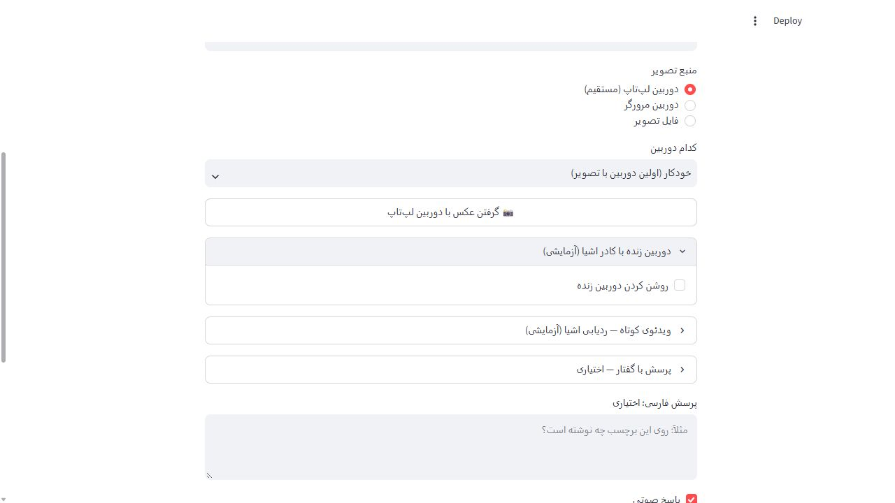

*These screenshots show the actual local Streamlit application on Windows. They show the interface and camera controls; no camera image was captured and no model inference was run for these screenshots. They do not depict a completed detection result.*

The laptop-camera workflow connects **image capture → a selected analysis task → a Persian text or spoken response**. Live detection and video tracking remain experimental.

### Recorded Windows example

The following frames come from the owner-provided screen recording, not the mobile preview. The example shows an uploaded kangaroo image and a later Persian answer with its audio player.

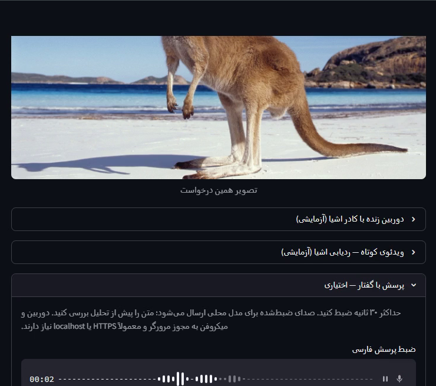

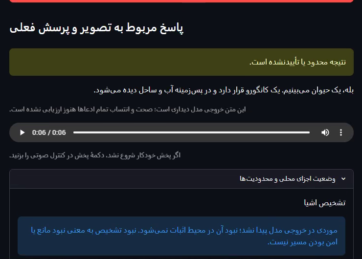

*Source: owner-provided recording, approximately 00:56 and 02:27. Frames are cropped to the application area; the original recording is unchanged. This example uses an uploaded image, not a webcam capture. The displayed answer is a recorded example, not an independent accuracy assessment or a latency benchmark.*

### Recorded camera capture and grounded output

These application-only frames show the camera workflow in the supplied Windows recordings: a phone in the browser-camera view, its later Persian description and audio player, and a separate object-detection example.

| Camera input | Persian answer |
| --- | --- |
| 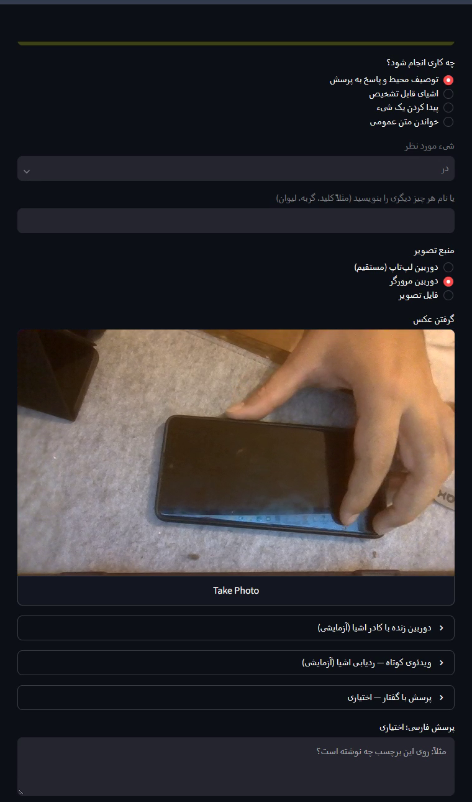 | 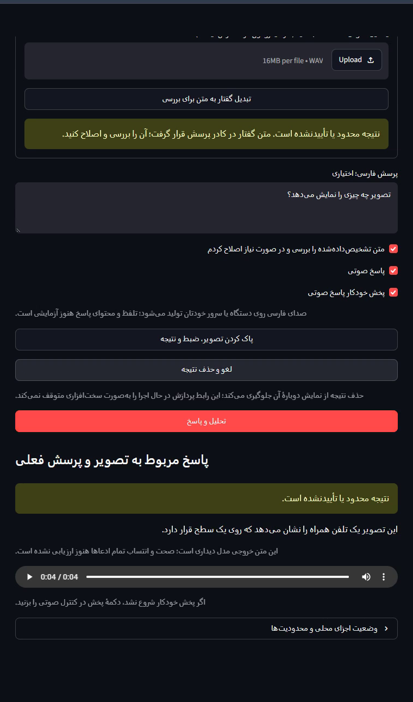 |

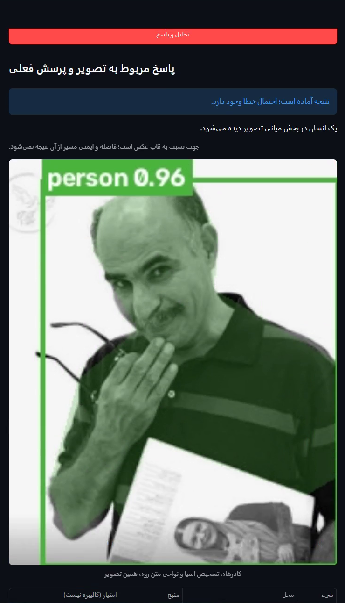

*Camera capture and phone answer: recording 0015, approximately 00:19 and 01:33. Object box: recording 0016, approximately 01:07, using an uploaded image. The on-screen uncertainty notices are retained. Detector scores are uncalibrated model outputs, not measured accuracy. These are selected recorded examples, not continuous live tracking or a timing benchmark.*

## Phone-oriented web interface

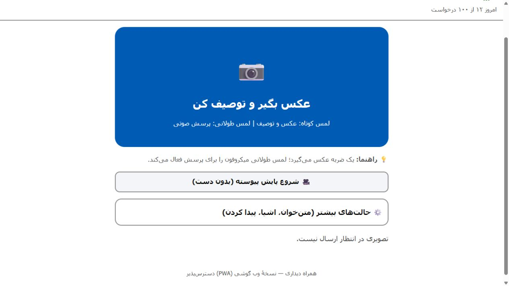

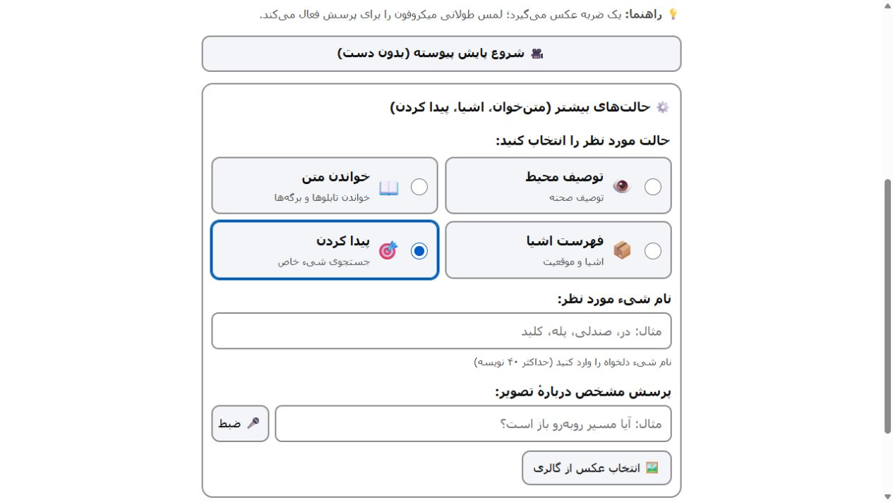

*Screenshots show the actual web interface connected to its development preview server. Readiness and quota indicators are simulated; these images are UI previews, not evidence of model accuracy or a live deployment. No participant photographs or recordings are included.*

## The engineering behind the interface

- **A shared multimodal pipeline:** Streamlit and a phone-oriented web interface connect to the same analysis concepts.
- **Replaceable components:** vision-language, detection, OCR, speech recognition and speech synthesis sit behind explicit result contracts.
- **Persian handling:** text normalization and speech preparation are part of the response path.
- **Bounded processing:** validated image/audio inputs, request state and cancellation handling, controlled inference access and daily usage quotas.
- **Careful output:** relative directions stay tied to the camera frame; uncertain OCR numbers are not automatically spoken as confirmed facts.
- **Testable boundaries:** model substitutes let interface, API, state and validation behavior be tested without running GPU inference.

Implemented components include Python, Streamlit, FastAPI, a PWA frontend, Qwen vision-language adapters, RT-DETR detection, EasyOCR, Whisper and configurable Persian speech backends. The work integrates existing model families; it does not claim to have trained a foundation model from scratch.

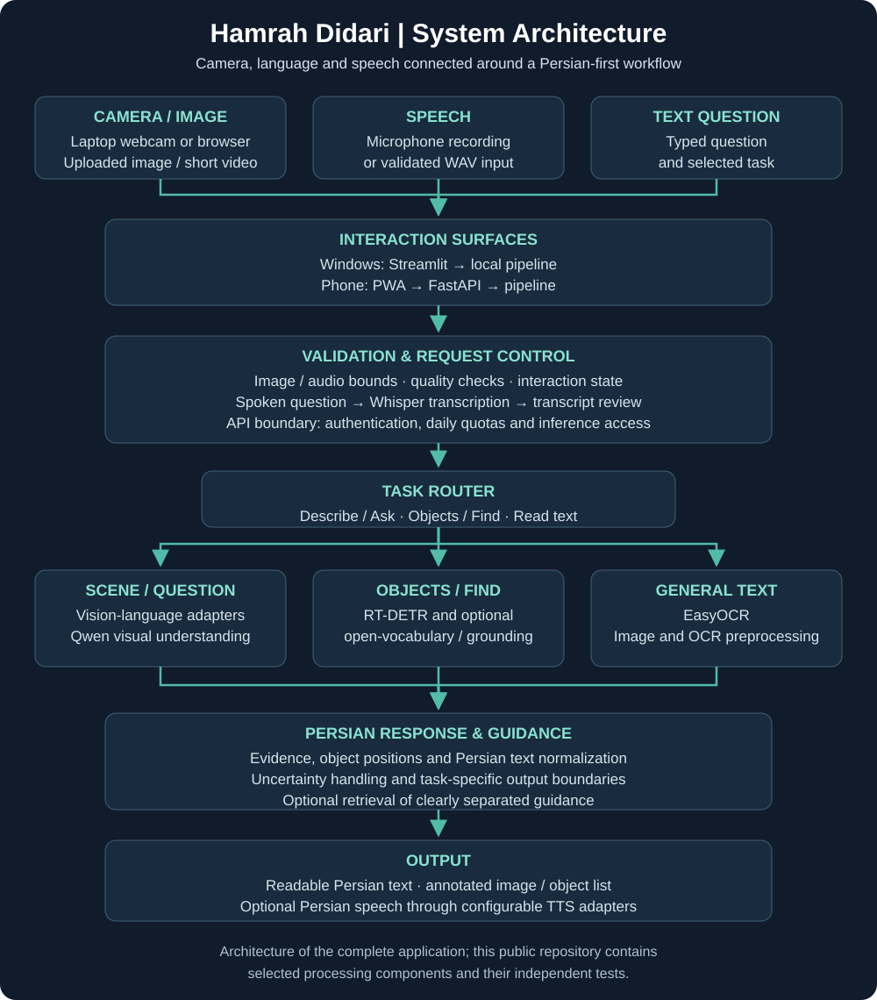

[Open the complete diagram](assets/architecture.svg)

## Verification snapshot

**Published selection: 21 tests and 6 subtests passed locally.** [Windows/Linux checks](https://github.com/Developesar/hamrah-didari/actions/workflows/components.yml).

**266 software tests + 29 subtests passed on 2 November 2026.** These exercise application behavior and controlled backend contracts. They do not establish real-world model accuracy, accessibility acceptance or production readiness. See the [verification notes](docs/VALIDATION.md) for scope.

This is a course capstone and an evolving assistive-technology prototype. It is not a navigation safety system; medicine-label reading is outside its scope. Field testing with blind and low-vision users and physical-device screen-reader checks remain open.

## Course and project context

The capstone connects computer vision, OCR, language processing, speech interfaces and application engineering in a single use case. Thank you to **Sematec** and **Vahid Ghorbani** for the course instruction.

For technical discussion, evaluation opportunities or collaboration, [contact Mohamadmilad Hadad on LinkedIn](https://www.linkedin.com/in/mohamadmilad-hadad-1026761ba/).
